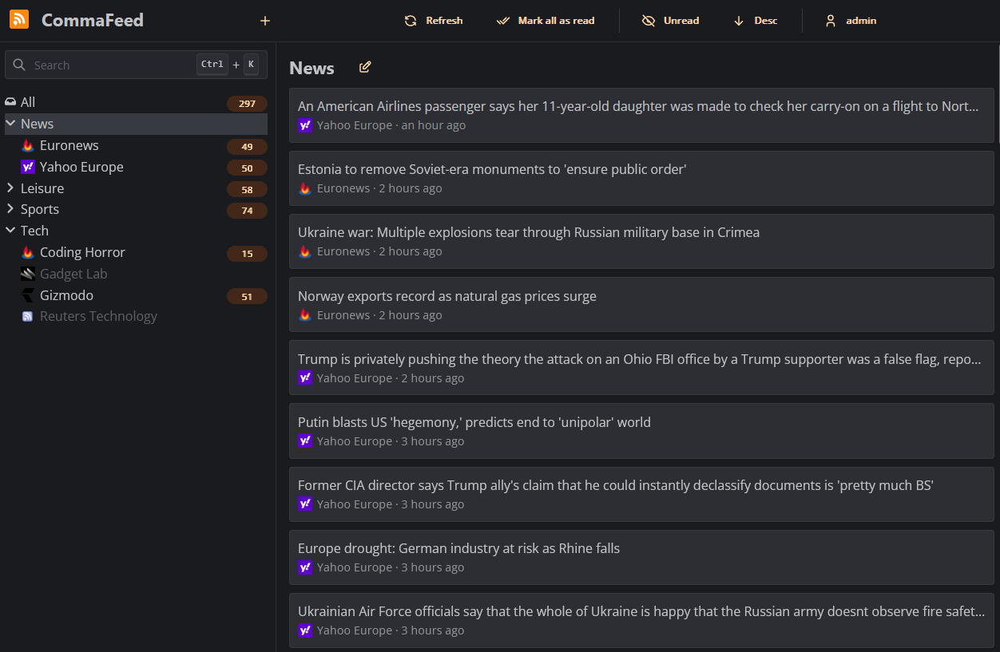

# CommaFeed

CommaFeed is a Google Reader-inspired self-hosted RSS reader: subscribe to feeds, organize them into categories, and read everything in one fast web UI — with Fever and Google Reader APIs for mobile apps. This repo is a one-click Railway wrapper around the official image (Athou/commafeed 7.4.1, Apache-2.0), with the admin account auto-seeded and data persisted on a volume.

Screenshot: upstream CommaFeed preview (Athou/commafeed README).

## Source Repository

[https://github.com/INAPP-Mobile/commafeed](https://github.com/INAPP-Mobile/commafeed)

## Deploy and Host

Click **Deploy on Railway** above. The deploy form has two generated fields — an admin password and a session encryption key — and nothing else to fill in. On first boot the entrypoint creates the admin account (`admin` + your generated password) via CommaFeed's first-run setup API; log in and subscribe to your first feed.

## Why Deploy

- **Zero-field-ish deploy:** two generated secrets, no wizard, no email step. The admin account is seeded automatically on first boot.
- **Real RSS reader, not a demo:** categories, keyboard shortcuts, rules, OPML import/export, Fever and Google Reader APIs so mobile apps (NetNewsWire, Reeder, ReadKit, etc.) can connect.
- **Always-on by design:** feeds refresh on a schedule, so the service earns its keep — and stays readable the moment you open it.
- **Persistent:** the embedded H2 database, search index, and uploads live on a Railway volume (`/commafeed/data`) and survive redeploys.
- **Pinned upstream:** the official `athou/commafeed:7.4.1-h2` JVM image, pinned by digest — no `:latest` drift.

## Common Use Cases

- Replace Google Reader-style reading: one inbox for blogs, news, and YouTube channels.
- A private, ad-free feed reader that syncs with your mobile RSS app via the Fever / Google Reader APIs.
- Team or family feed hub: the admin adds accounts from the user menu (open registration stays off by default).

## Configuration

| Variable | Default | What it does |
|---|---|---|
| `COMMAFEED_ADMIN_PASSWORD` | `${{secret(16)}}` (generated) | Password for the auto-seeded admin account (`admin`). Set once on first boot; changing it later does not reset the admin password. |
| `QUARKUS_HTTP_AUTH_SESSION_ENCRYPTION_KEY` | `${{secret(32)}}` (generated) | Fixed key encrypting login session cookies (min 16 chars). Without a fixed value, logins are lost on every restart. |
| `PORT` | Railway-injected | Mapped to `QUARKUS_HTTP_PORT` by the entrypoint on every boot. Do not set it yourself. |
| `COMMAFEED_HTTP_CLIENT_BLOCK_LOCAL_ADDRESSES` | `true` | Blocks subscribing to feeds on private/local addresses (SSRF protection). Set to `false` only if you trust every user. |
| `COMMAFEED_FEED_REFRESH_INTERVAL` | `PT30M` | How often feeds are refreshed. |
| `COMMAFEED_USERS_ALLOW_REGISTRATIONS` | `false` | Allow open registration of new accounts. Off by default — the admin adds users. |
| `COMMAFEED_USERS_MINIMUM_PASSWORD_LENGTH` | `4` | Minimum password length for user accounts. |

All other Quarkus settings can be overridden with environment variables (e.g. `COMMAFEED_FEED_REFRESH_INTERVAL_EMPIRICAL`); see the [upstream Docker Hub page](https://hub.docker.com/r/athou/commafeed).

### Deployment Dependencies

- **Runtime:** single Java (Quarkus) service from the official JVM image; heap capped at 512 MB (`-Xmx512m`).
- **Port:** 8082 internally, mapped from Railway's injected `PORT`.
- **Persistence:** one Railway volume mounted at `/commafeed/data` (H2 database, Lucene index, uploads).
- **Healthcheck:** upstream's own `/openapi` endpoint (always included, unauthenticated, 200).
- **Plan tier:** runs on Railway's Hobby plan; no companion services.
