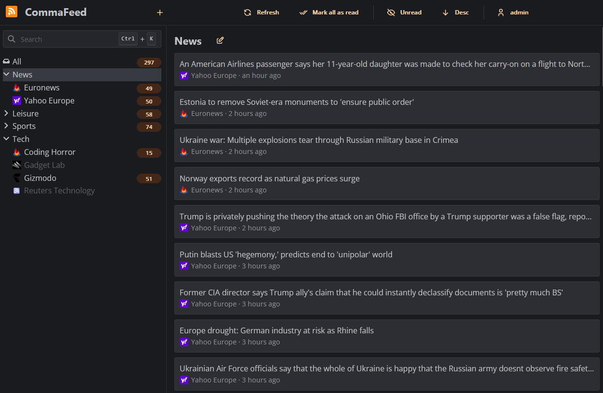

Screenshot: upstream CommaFeed preview (Athou/commafeed README).

# Deploy and Host

CommaFeed is a Google Reader-inspired self-hosted RSS reader: subscribe to feeds, organize them into categories, and read everything in one fast web UI — with Fever and Google Reader APIs for mobile apps. One click deploys the official image (Athou/commafeed 7.4.1, Apache-2.0) as a single service with an embedded H2 database. The deploy form has two generated fields — an admin password and a session encryption key — and nothing else to fill in. On first boot the admin account (`admin` + your generated password) is created automatically; log in and subscribe to your first feed.

## About Hosting

CommaFeed runs as one Quarkus native-binary service from the official image, pinned by digest. The embedded H2 database, search index, and uploads live on a Railway volume (`/commafeed/data`) and survive redeploys. The native binary boots in about a second and runs comfortably in 256 MB, so it fits easily on the Hobby plan with no companion services. Railway's injected `PORT` is mapped to the app port on every boot, and the healthcheck is upstream's own `/openapi` endpoint.

## Why Deploy

- **Zero-fuss start:** no setup wizard to click through, no email step — the admin account is seeded on first boot.
- **Real RSS reader:** categories, keyboard shortcuts, rules, OPML import/export, and Fever / Google Reader APIs so mobile apps (NetNewsWire, Reeder, ReadKit) can connect.
- **Always-on by design:** feeds refresh on a schedule, so your reader is current the moment you open it.
- **Private by default:** open registration stays off; the admin adds accounts from the user menu.

## Common Use Cases

- Replace Google Reader-style reading: one inbox for blogs, news, and YouTube channels.
- A private, ad-free feed reader that syncs with your mobile RSS app via the Fever / Google Reader APIs.
- Team or family feed hub: the admin adds accounts; everyone gets their own subscriptions and read state.

## Dependencies for

### Deployment Dependencies

- **Runtime:** single Quarkus native-binary service; runs in ~256 MB.
- **Port:** 8082 internally, mapped from Railway's injected `PORT`.
- **Persistence:** one Railway volume at `/commafeed/data` (H2 database, Lucene index, uploads).
- **Healthcheck:** `/openapi` (upstream endpoint, unauthenticated).
- **Plan tier:** Hobby plan; no companion services.

**Environment variables (condensed reference):** `COMMAFEED_ADMIN_PASSWORD` (`${{secret(16)}}` — admin password, set once on first boot), `QUARKUS_HTTP_AUTH_SESSION_ENCRYPTION_KEY` (`${{secret(32)}}` — fixed session-cookie key; logins are lost on restart without it), `COMMAFEED_HTTP_CLIENT_BLOCK_LOCAL_ADDRESSES` (default `true` — SSRF protection for feed URLs), `COMMAFEED_FEED_REFRESH_INTERVAL` (default `PT30M`), `COMMAFEED_USERS_ALLOW_REGISTRATIONS` (default `false`), `COMMAFEED_USERS_MINIMUM_PASSWORD_LENGTH` (default `4`). `PORT` is injected by Railway and mapped automatically.
